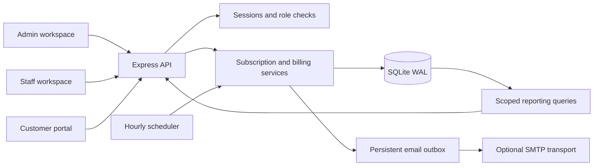
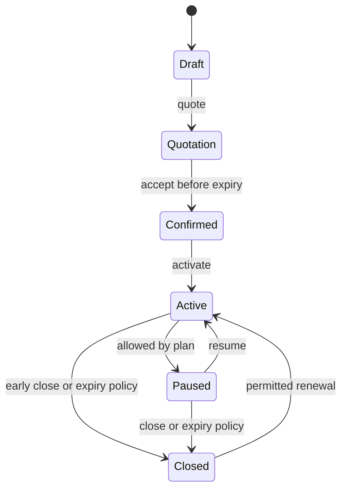

# How Brightloop works

## Components

The frontend never decides whether an action is authorized. Each API mutation enforces roles, ownership, state, dates, quantities, and money constraints. Portal queries scope every subscription, invoice, and metric to the current customer. Public product options omit cost prices. Existing customer records cannot be claimed through public signup: an administrator issues a portal invitation.

## Financial invariants

1. Amounts are integer **paise**. BigInt ratio calculations handle fractional discounts/taxes. Largest-remainder allocation distributes discount paise without making any line negative.
2. A subscription snapshots product names, variants, unit prices, base-plan price, and interval. Catalog price edits do not silently change existing contracts.
3. Invoices snapshot customer details, lines, tax rates, discounts, totals, and cycle dates. Later edits do not rewrite issued records.
4. `UNIQUE(subscription_id, cycle_date)` guards duplicate billing. Invoice creation, discount consumption, audit entry, and next billing cursor share one `BEGIN IMMEDIATE` transaction.
5. Discounts evaluate against the **service cycle date**, including catch-up billing. Rules apply in creation order. Minimum purchase uses the undiscounted subtotal; minimum quantity excludes the plan base fee. Tax applies after discounts and rounds per line.
6. Payments require a confirmed invoice and cannot exceed its balance. A unique idempotency key binds to the complete receipt payload. Payment insertion, balance/status changes, and audit logging are atomic.
7. Cancellation is allowed only before any payment. It waives that cycle, releases discount uses, and retains the cycle key to prevent automatic rebilling. Refunds and credit notes are outside this MVP.
8. Monthly/yearly cycles retain the original day as an anchor: January 31 → February 28/29 → March 31. All date-only values are validated as real UTC calendar dates.

## Lifecycle and terms

Billing covers cycles starting before the exclusive term expiry. Auto-close plans close after historical due cycles are generated. Other expired terms remain visible but do not bill past expiry until renewed.

Pending billing must finish before pausing, closing, or changing active products. Resume skips cycles elapsed during the pause; existing invoices remain collectible. Renewing a closed term restarts service today without billing the gap. Plan policies apply to all roles.

Teams can change future product quantities/add-ons. Customers can change add-ons only; base lines are compared against the saved contract on the server. Existing unit prices remain fixed, while newly added products use current prices. Changes take effect at the next unbilled cycle without proration or refunds.

## Scheduling and email

Billing runs hourly. Production startup also catches up missed cycles. A batch handles up to 1,000 subscriptions and 2,000 invoice cycles. Scheduled processing drains remaining batches, yielding to requests between transactions. The manual UI offers continuation for large backlogs.

Messages enter a persistent outbox before delivery. Without SMTP, admins can preview them; with SMTP, delivery runs after the request or during scheduled work. Failed messages have an explicit retry action. SMTP is at-least-once: a crash after provider acceptance but before the local update can duplicate an email. A mail provider with idempotent delivery is the stronger production extension.

One server process owns scheduling. SQLite locks and unique indexes remain authoritative during overlapping manual requests. Keep the database, WAL, and shared-memory files on the same local persistent volume.

## Security choices

- Scrypt with independent salts; passwords require 9+ characters, uppercase, lowercase, and a symbol.
- Random 256-bit session tokens, stored only as SHA-256 hashes; seven-day expiry; HttpOnly/SameSite=Lax cookies and Secure cookies in production.
- Hashed, single-use reset/invitation tokens with 30-minute expiry. Reset revokes all user sessions; reset requests do not reveal account existence.
- Case-insensitive unique emails, role enforcement, ownership checks, and admin-only staff provisioning.
- Parameterized SQL, Zod validation, bounded JSON bodies, authentication rate limits, origin checks for JSON mutations, Helmet headers, escaped print HTML, and formula-safe CSV.
- Tagged demo databases are rejected when booting production with demo disabled.
- Reset links in the outbox are intentionally admin-only. Use fictional data for public demonstrations.

## Reporting definitions

MRR is the current active, in-term pretax contractual total, normalized by interval: monthly ×1, yearly ÷12, weekly ×52/12, daily ×365/12. It excludes discounts. ARR is MRR ×12. Labels disclose this basis.

Collected cash uses receipt dates in the selected range. Confirmed billing uses invoice issue dates. Outstanding/overdue balances describe **current** confirmed receivables regardless of the date filter; drafts and cancelled invoices are excluded. Overdue means due before today's UTC date. Plan and customer filters apply consistently.

## Scale path

The measured fixture contains 10,000 subscriptions, 60,000 invoices, and 50,000 payments. Pagination, indexes, and WAL kept local page API p95 under two seconds. This is not a multi-instance or concurrent production-load guarantee.

For multiple instances, move to PostgreSQL, introduce versioned migrations, and put billing on a leased worker queue. Replace `BEGIN IMMEDIATE` with row-level locking while preserving cycle/receipt uniqueness. Materialize monthly aggregates as volume grows. Add shared rate limits, provider idempotency, monitoring, restore drills, gateway webhooks, refunds/credit notes, and account verification before operating at production scale.
